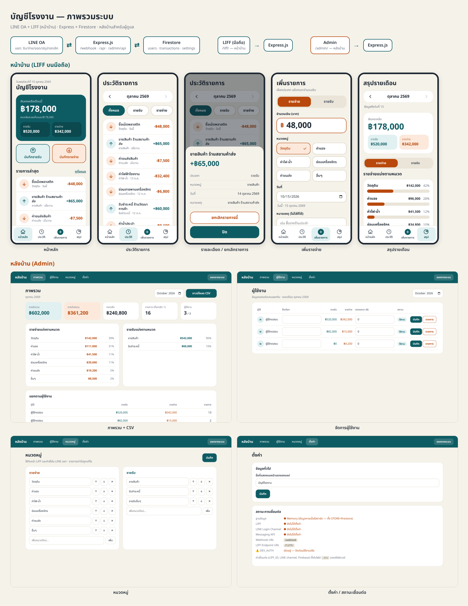

# ระบบบันทึกรายรับ-รายจ่ายโรงงาน ผ่าน LINE OA

Express.js + Firestore + LINE LIFF (มีหลังบ้านสำหรับตั้งค่า)



เอกสาร: [ER Diagram](docs/ER.md) · [ภาพ ER](docs/er-diagram.png) · ภาพหน้าจอทั้งหมดใน `docs/screenshots/`

## ฟังก์ชันทั้ง 7 ข้อ
| # | ฟังก์ชัน | LIFF | LINE แชท |
|---|---|---|---|
| 1 | บันทึกรายรับ | แท็บ "เพิ่มรายการ" | `รับ 5000 ขายสินค้า ร้านสยาม` / `+5000` |
| 2 | บันทึกรายจ่าย | แท็บ "เพิ่มรายการ" | `จ่าย 300 วัตถุดิบ เม็ดพลาสติก` / `-300` |
| 3 | แยกข้อมูลผู้ใช้ | ทุก query กรองด้วย `userId` จาก LINE ID token ที่ verify ฝั่งเซิร์ฟเวอร์ | แยกตาม `source.userId` |
| 4 | สรุปรายรับรายเดือน | แท็บ "สรุป" → รายรับ | `สรุป` |
| 5 | สรุปรายจ่ายรายเดือน | แท็บ "สรุป" → รายจ่าย | `สรุป` |
| 6 | ยอดคงเหลือ | หน้าหลัก (เดือนนี้ + สะสม) | `ยอด` |
| 7 | ยกเลิกรายการ | กดรายการ → ยกเลิก / ปุ่มเลิกทำหลังบันทึก | `ยกเลิก` / `ยกเลิก A1B2` |

การยกเลิกเป็น soft delete (เก็บประวัติ, ไม่นับในยอด)

## หลังบ้าน `/admin/`
ภาพรวมรายเดือน + ดาวน์โหลด CSV · จัดการผู้ใช้ (ชื่อเรียก, ยอดยกมา, ระงับ/เปิด, ดู/ยกเลิกรายการ) · แก้หมวดหมู่รายรับ/รายจ่าย · ชื่อแอป · สถานะการเชื่อมต่อ

## ติดตั้ง
```bash
npm install
cp .env.example .env   # แล้วเติมค่าที่เว้นไว้
npm start
npm test
```

### รันในเครื่องด้วย Docker
```bash
docker compose up --build
```
- แอป: http://localhost:3000/liff/ · หลังบ้าน: http://localhost:3000/admin/ (ค่าเริ่มต้น `admin` / `admin1234`)
- ใช้ Firestore emulator ใน container (ไม่ต้องมีบัญชี Firebase) และเปิด `DEV_AUTH` เพื่อทดสอบโดยไม่ต้อง login LINE
- ข้อมูลในเครื่องจะหายเมื่อ `docker compose down` (emulator เก็บในหน่วยความจำ)
- อยากต่อ LINE จริง: ใส่ค่า `LIFF_ID` / `LINE_*` ใน `.env` แล้วเปิด tunnel (เช่น ngrok) ชี้มาที่พอร์ต 3000 และตั้ง `DEV_AUTH=false`
- รันเฉพาะแอปบน production: `docker build -t factory-ledger . && docker run --env-file .env -p 3000:3000 factory-ledger`

### ค่าที่ต้องเติมใน `.env`
- `LIFF_ID`, `LINE_LOGIN_CHANNEL_ID` — LINE Login channel (LIFF Endpoint URL = `https://<โดเมน>/liff/`, scope: `openid profile`)
- `LINE_CHANNEL_SECRET`, `LINE_CHANNEL_ACCESS_TOKEN` — Messaging API (Webhook URL = `https://<โดเมน>/webhook`)
- `FIREBASE_PROJECT_ID` + `FIREBASE_SERVICE_ACCOUNT_JSON` (หรือ `GOOGLE_APPLICATION_CREDENTIALS`), `STORE=firestore`
- `ADMIN_USERNAME`, `ADMIN_PASSWORD`, `SESSION_SECRET`
- `DEV_AUTH=true` ใช้ทดสอบในเครื่องเท่านั้น (ข้ามการ login LINE; ใช้ `STORE=memory` ได้)

### Firestore
คอลเลกชัน `users`, `transactions`, `settings/app` — query ใช้ equality อย่างเดียว **ไม่ต้องสร้าง composite index**
ควรตั้ง Firestore Rules เป็น deny-all (เข้าถึงผ่านเซิร์ฟเวอร์เท่านั้น):
```
match /{document=**} { allow read, write: if false; }
```

### Rich menu (แนะนำ)
ตั้งปุ่มใน LINE OA ให้เปิด `https://liff.line.me/<LIFF_ID>?tab=add&type=expense` เป็นต้น (`tab` = home | history | add | summary)
