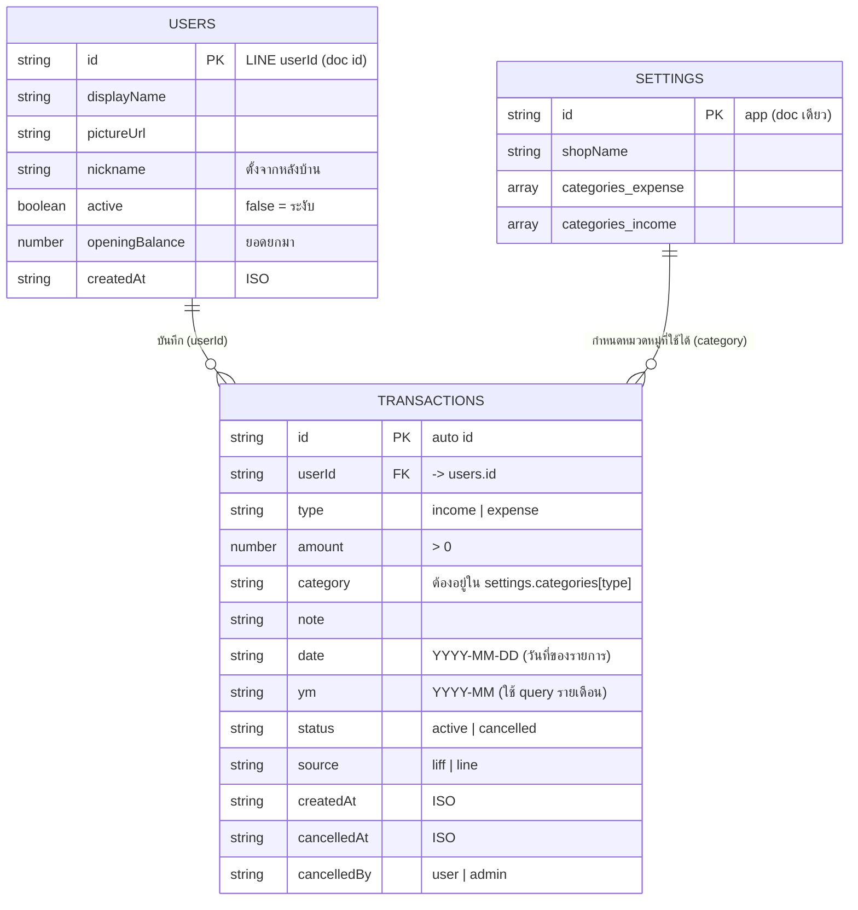

# ER Diagram (Firestore)

- Firestore เป็น NoSQL: `transactions.userId` เป็นการอ้างอิงด้วยค่า ไม่มี foreign key จริง
- `category` ในรายการเก็บเป็นข้อความ จึงแก้/ลบหมวดที่หลังบ้านได้โดยไม่กระทบรายการเก่า
- Query ทุกตัวใช้ equality (`userId`, `ym`) จึงไม่ต้องสร้าง composite index
- ยอดสรุป/คงเหลือคำนวณจากรายการที่ `status = active` ไม่เก็บยอดสะสมซ้ำ
